### Olá, sou o Bruno 👋

**Arquiteto de software e analista de sistemas** em Caraguatatuba, Litoral Norte de SP.
Entendo o problema, organizo o domínio e construo tecnologia que aguenta o dia a dia, em sistemas legislativos, saúde, educação e dados.

- 🏛️ Cuido da tecnologia da **Câmara Municipal de Caraguatatuba**
- 🚀 Fundei a **PR Tecnologia** com minha esposa: sistemas, automações, consultoria e IA aplicada
- 🔐 Especialização em Proteção de Dados (LGPD/GDPR) e IA para negócios
- 🎮 Organizo a **Litoral Game Jam 2026**

#### 🔨 Projetos em destaque

| Projeto | O que é | Status |
|---|---|---|
| [**OpenData Query AI**](https://github.com/rangelbruno/opendataquery) | Pergunte aos seus dados em português: conecta PostgreSQL, MySQL, MongoDB ou planilhas e gera consultas somente leitura | Open source (MIT) |
| [**Tribunal 2.0**](https://github.com/rangelbruno/tribunal) | Assina PDFs com certificado A3, divide PDFs e aplica OCR para torná-los pesquisáveis | Open source |
| **AZClinic** | Gestão de clínicas: agenda, pacientes, prontuário e documentos | No ar |
| **HUB de Jogos** | Plataforma que reúne jogos para jogar e descobrir | No ar |

#### 🧰 Como eu trabalho

1. **Contexto antes do código.** Domínio, regra de negócio e operação vêm primeiro.
2. **Arquitetura na medida.** Simples quando possível, robusta quando necessário.
3. **IA aplicada, não de vitrine.** Uso prático para automatizar e acelerar entregas.
4. **Dados que viram decisão.** Indicador só serve se ajuda a agir.

<!-- cool-readme:start -->
<!-- Cards by github-cool-readme: https://github.com/pedrocatalao/github-cool-readme -->

<picture>
  <source media="(prefers-color-scheme: dark)" srcset="https://raw.githubusercontent.com/rangelbruno/rangelbruno/cards/summary-dark.svg">
  
</picture>
<picture>
  <source media="(prefers-color-scheme: dark)" srcset="https://raw.githubusercontent.com/rangelbruno/rangelbruno/cards/languages-dark.svg">
  
</picture>

<picture>
  <source media="(prefers-color-scheme: dark)" srcset="https://raw.githubusercontent.com/rangelbruno/rangelbruno/cards/weekly-dark.svg">
  
</picture>
<picture>
  <source media="(prefers-color-scheme: dark)" srcset="https://raw.githubusercontent.com/rangelbruno/rangelbruno/cards/streaks-dark.svg">
  
</picture>

<!-- cool-readme:end -->

#### 📫 Contato

🌐 [rangelbruno.org](https://rangelbruno.org)
